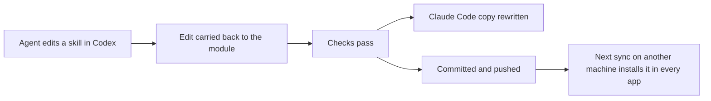

# agent-kit-sync

agent-kit-sync keeps your coding-agent setup the same on every computer you use. It syncs skills, subagent definitions, hooks, sections of instruction files such as `CLAUDE.md` and `AGENTS.md`, and chosen agent settings, through a private Git repository you own. When an agent edits one of those files on any machine, the edit reaches the other agent apps on that machine and then every other machine.

A hook is a program an agent app runs automatically at set moments, such as before every tool call. Hooks run with your own permissions, which is why most of this README is about who can change them and when.

## Contents

- [Keep your config repo private](#keep-your-config-repo-private)
- [What reaches each agent app](#what-reaches-each-agent-app)
- [Requirements](#requirements)
- [Set up the first machine](#set-up-the-first-machine)
- [Add another machine](#add-another-machine)
- [How syncing works](#how-syncing-works)
- [What deletion does](#what-deletion-does)
- [Checks before anything is pushed or installed](#checks-before-anything-is-pushed-or-installed)
- [Add something to sync](#add-something-to-sync)
- [Instruction sections](#instruction-sections)
- [Hooks](#hooks)
- [Agent settings](#agent-settings)
- [Per-machine changes](#per-machine-changes)
- [Shared memory](#shared-memory)
- [Updates to agent-kit-sync itself](#updates-to-agent-kit-sync-itself)
- [When something goes wrong](#when-something-goes-wrong)
- [Cloud sessions](#cloud-sessions)
- [Commands](#commands)
- [Uninstall](#uninstall)
- [Security](#security)
- [Current limits](#current-limits)
- [Contributing](#contributing)
- [License](#license)

## Keep your config repo private

Your config repo holds instructions and hook code that run with your permissions, and usually text about your work. Keep it private. Setup checks whether the repository can be read without signing in. If it can, setup warns you before it continues.

agent-kit-sync accepts no responsibility for anything that leaks from a public config repo, or from any config repo.

## What reaches each agent app

| Item | Claude Code | Codex | Cursor |
|---|---|---|---|
| Skills | `~/.claude/skills/` | `~/.agents/skills/` | Reads the Claude Code and Codex folders |
| Subagent definitions | `~/.claude/agents/` | `~/.codex/agents/` (TOML) | `~/.cursor/agents/` |
| Instruction sections | `~/.claude/CLAUDE.md` | `~/.codex/AGENTS.md` | Not yet |
| Agent settings | `~/.claude/settings.json` | `~/.codex/config.toml` | Not yet |
| Hooks | Registered in `settings.json` | Registered in `hooks.json` | Runs Claude Code's hooks |

`CLAUDE_CONFIG_DIR` and `CODEX_HOME` move Claude Code's and Codex's folders, and agent-kit-sync follows them. A machine gets copies only for the apps it has. Antigravity is not supported yet.

## Requirements

You need Git and Python 3.9 or later.

| System | Check | Install |
|---|---|---|
| macOS | `git --version` and `python3 --version` | `xcode-select --install`, or `brew install git python` |
| Windows | `git --version` and `py -3 --version` | `winget install --id Git.Git -e` and `winget install --id Python.Python.3.13 -e` |
| Linux | `git --version` and `python3 --version` | Your distribution's package manager, such as `sudo apt install git python3` |

Every hook call starts Python once. On an Apple silicon Mac in November 2026, a tool call with no matching hook took 78 ms with the Python 3.9 that macOS includes and 49 ms with Python 3.14, so setup recommends the newest Python on the machine.

## Set up the first machine

Paste this into Claude Code or Codex:

> Clone the agent-kit-sync repository, REPO_URL, into a temporary folder. Then read `kit/skills/agent-kit-sync-setup/SKILL.md` in that clone and follow it to set up agent-kit-sync on this machine.

Replace REPO_URL with the address of this repository, or of your fork, from the **Code** button on its GitHub page.

The agent asks you, each with a recommendation:

- which config repo to use, or whether to create a private one;
- this machine's name, tags, and Git identity for the config repo;
- the [policy](#per-machine-changes) for what this machine applies by itself;
- where your projects folder and worktrees folder are;
- which terms must never reach the config repo, such as your employer's name.

Before you have answered every question, setup only creates `~/.agent-kit-sync`, reads the machine, and tests this machine's existing hooks with a temporary home folder. Nothing in any agent app's folders changes until then.

## Add another machine

Use the same prompt. The agent compares what the machine already has with your config repo. For each pair of items that do the same job, whatever their names, it shows you both and recommends one of three outcomes:

- your config repo's version replaces the local one;
- the local version replaces the config repo's;
- the two are merged, and the result syncs everywhere.

It also lists the machine's other skills, hooks, and instruction sections, and recommends which to add to the config repo, which to keep on this machine only, and which to leave alone. Nothing is replaced or removed without your answer, and each replaced file is backed up first.

## How syncing works

A sync runs in the background when a session starts, after an agent writes a file, and at the end of a turn when an installed copy changed. You can also run `agent-kit-sync sync`. A sync that succeeds prints nothing and adds nothing to any agent's context.

A run does these steps in order:

1. Find edits to installed copies, and settings that another program changed.
2. Carry each edit back to the module it came from, and check it.
3. Rewrite the other copies of that item in every app on this machine.
4. Commit what passed, and merge what other machines pushed.
5. Apply this machine's policy to incoming changes, then install them.
6. Push.



Local copies are rewritten before the push, so an edit reaches every app on this machine even without a network connection.

## What deletion does

Deleting an installed copy deletes that item from the config repo and from every machine. To remove something from one machine only, run `agent-kit-sync disable MODULE/ITEM`.

agent-kit-sync holds a deletion for your decision instead when an agent app's whole folder is missing, when more than three items vanish in one run, or when another machine edited the same item since this machine last synced. `agent-kit-sync undo` reverses this machine's most recent run that changed anything, including on other machines for changes this machine pushed.

## Checks before anything is pushed or installed

Every check runs on your machine. Nothing uses a hosted service.

| Check | Fails on | Applies to |
|---|---|---|
| Format | A module file that cannot be read, a missing file, or an unknown placeholder | Everything |
| Machine-specific values | This machine's home folder, user name, or host name; a path under any user's folder; a drive letter; a fixed interpreter path such as `/opt/homebrew/bin/python3` | Your own files |
| Blocklist | Any term in `~/.agent-kit-sync/blocklist.txt` | Your own files |
| Secrets | Text shaped like a GitHub token, cloud key, private key, or API key | Your own files |
| Python syntax | A Python file that does not compile | Everything |

An edit that fails is held on this machine and never committed. The blocklist is a plain text file with one term per line; edit it any time.

## Add something to sync

Run `agent-kit-sync add PATH --module MODULE`, or ask an agent, which follows the bundled `agent-kit-sync-add` skill. Add `--local` to keep it on this machine only.

A module is a folder in your config repo that groups items that work together, such as a rule's instruction section, the hook that enforces it, and that hook's tests. A minimal module:

```text
modules/writing/
  module.toml
  sections/plain.md
  skills/review/SKILL.md
```

```toml
description = "Writing rules"

[[sections]]
name = "plain"
file = "sections/plain.md"

[[skills]]
name = "review"
dir = "skills/review"
```

Text in sections and subagent definitions can use placeholders, which become this machine's values: `{{kit.home}}`, `{{kit.projects}}`, `{{kit.worktrees}}`, `{{kit.module}}`, `{{kit.app}}`, `{{kit.os}}`, and `{{kit.cli}}`. `{{kit.hook MODULE/HOOK}}` becomes the command that runs one synced hook, for a hook that belongs inside a subagent definition. In a skill, placeholders are replaced only in the files listed under `templates`. Write `{{kit.literal home}}` to show a placeholder literally.

Lines that only some apps should see go between two marker lines, each alone on its line:

```markdown
{{kit.only claude cursor}}
A hook in this file runs every shell command in a read-only sandbox.
{{kit.end}}
```

The block's lines appear in the listed apps' copies, and the marker lines appear in none. A block cannot sit in a subagent definition's header; write a field for one app with that app's name in front, such as `claude.tools`. An edit made in an app's copy that adds or removes lines directly before or after a block is held, because those lines could belong inside the block or outside it; make that change in the module's file.

These files never sync: `.DS_Store`, `Thumbs.db`, `desktop.ini`, `__pycache__`, `*.pyc`, `.pytest_cache`, `node_modules`, `.git`, and editor backups. A module can add patterns with `ignore = [...]`.

Before adding a hook or script, have an agent follow the bundled `portable-scripts` skill. It finds anything that works on only one machine and offers a rewrite with tests.

## Instruction sections

Each section is written into an instruction file between two marker lines:

```markdown
<!-- agent-kit-sync begin writing/plain -->
Write plainly.
<!-- agent-kit-sync end writing/plain -->
```

agent-kit-sync changes only text between its own markers. New sections are added at the end of the file; move a block anywhere and it stays there. A section can have different wording for one app with `variants = { codex = "sections/plain.codex.md" }`.

When an instruction file first grows past 32 KiB, agent-kit-sync raises one alert listing the largest sections, because Codex cuts off instruction files it finds in project folders at that size. Codex reads `AGENTS.override.md` instead of `AGENTS.md` when that file exists, and `agent-kit-sync doctor` reports it.

## Hooks

Each agent app gets one registered command per event, the dispatcher, which runs every synced hook for that event. Changing a hook's code never changes an app's settings. Codex asks you to approve each registered entry once, in its `/hooks` screen.

```toml
[[hooks]]
name = "no-rm"
file = "hooks/no_rm.py"
events = ["pre_tool_use"]
tools = ["shell"]
protocol = "native"
timeout = 10
on_failure = "open"
tests = ["tests/test_no_rm.py"]
```

| Field | Values |
|---|---|
| `events` | `session_start`, `user_prompt`, `pre_tool_use`, `post_tool_use`, `stop`, `subagent_start`, `subagent_stop`, `pre_compact`, `session_end` |
| `tools` | `shell`, `read`, `write`, `edit`, `search`, `web`, `task`, `mcp`; leave it out for every tool |
| `protocol` | `native`: the hook reads and writes the app's own format, as an existing Claude Code or Codex hook does. `kit`: the hook reads one translated event and writes `{"decision": "allow" | "deny" | "ask" | "continue", "reason", "agent_context", "user_message"}`, the same on every app |
| `args` | Arguments for the hook, which may use placeholders, such as `["--app", "{{kit.app}}"]` |
| `runtime` | `python` (default), `node`, or `bash` |
| `on_failure` | `open`: a crash or timeout is reported and the action continues. `closed`: the action is blocked |

A hook fails when it exits with a code other than 0 or 2, prints output the dispatcher cannot read, or runs past its timeout. Where an app cannot ask the user to confirm, `ask` becomes `deny` with a reason telling the agent to ask.

If Python moves, such as after an upgrade, the registered commands cannot start. Run `agent-kit-sync repair` in a terminal; the command falls back to any `python3` on the path, or run `python3 ~/.agent-kit-sync/launcher.py repair` directly.

## Agent settings

```toml
[[settings]]
app = "claude"
key = "env.MAX_MCP_OUTPUT_TOKENS"
value = "10000"
```

`key` is a dotted path. With `mode = "contains"` and a list value, agent-kit-sync makes sure the list has those entries and leaves other entries alone. It changes only its own keys. In Codex's `config.toml` it edits one line and keeps comments.

When another program changes a synced setting, agent-kit-sync holds the change and asks whether to keep it and sync it, restore the synced value, or always restore it on this machine.

## Per-machine changes

`~/.agent-kit-sync/machine.toml` holds what only this machine knows. Its policy decides what the machine does by itself:

| Setting | Values | Recommended |
|---|---|---|
| `new_items` | `apply` or `ask` | `ask` |
| `code_changes` | `apply` or `ask` | `ask` |
| `other_changes` | `apply` or `ask` | `apply` |
| `outgoing` | `push`, `ask-code`, or `ask` | `ask-code` |
| `tool_updates` | `apply`, `ask`, or `pin` | `apply` |
| `approval` | `agent` or `terminal` | `agent` |

Code means anything that can run or change what agents may do without asking: hooks, scripts, non-Markdown files in skills, tests, hooks inside subagent definitions, and settings under `hooks`, `permissions`, `env`, and keys agent-kit-sync does not recognize. With the recommended values, text spreads by itself, and code moves between machines only after you approve it where it was written and where it arrives. With `approval = "terminal"`, approving a held change needs `yes` typed in an interactive terminal outside an agent session. An agent that can run commands in a terminal of its own could still type it, so treat this setting as a guard against mistakes, not against a determined agent.

An override changes one module or item on this machine only:

| Command | Effect |
|---|---|
| `agent-kit-sync disable MODULE/ITEM` | Not installed here |
| `agent-kit-sync override MODULE/ITEM replace --file FILE` | A local file is installed instead |
| `agent-kit-sync override MODULE/ITEM prepend --file FILE` | Local text goes before the synced text |
| `agent-kit-sync override MODULE/ITEM append --file FILE` | Local text goes after the synced text |
| `agent-kit-sync override MODULE/ITEM pin` | Stays at the current version until you remove the pin |

A local module has the same layout as any module, lives in `~/.agent-kit-sync/local/modules/`, and never syncs. Use it for anything about one employer or one machine.

## Shared memory

`agent-kit-sync remember "RULE"` adds a rule to a shared memory section that every app on every machine reads. `agent-kit-sync forget ID` removes one. Each app's own project memory stays on its machine.

## Updates to agent-kit-sync itself

Each sync fetches this repository's main branch. A new version is installed beside the running one and runs a self-test, and only then becomes current; a failing version is never used. The two previous versions are kept. Set `tool_updates = "ask"` to approve each update with `agent-kit-sync update --apply`, or `"pin"` to stay where you are.

## When something goes wrong

An alert appears in three places at once: a desktop notification, one line shown to you in each open session, and one line telling the agent which command shows it. The agent then follows the bundled `agent-kit-sync-resolve` skill.

| Command | Use |
|---|---|
| `agent-kit-sync status` | Open alerts, held changes, skipped modules, file sizes, and items not in your config repo |
| `agent-kit-sync held` | Each held change and its choices |
| `agent-kit-sync held resolve ID CHOICE` | Apply a choice |
| `agent-kit-sync doctor` | Check prerequisites, registrations, and Codex approvals |
| `agent-kit-sync repair` | Register the dispatcher again, after Python moved |
| `agent-kit-sync undo` | Reverse the most recent run that changed anything |

Two examples of held changes:

- **Another program reset a setting.** `held` shows `setting`, with the new value. Choose `always-restore` if the same program keeps doing it.
- **Two machines changed the same lines.** `held` shows `merge-conflict`. The other machine's version is installed, and this machine's is saved; choose `use-this` to keep this machine's instead.

## Cloud sessions

Claude Code's cloud sessions ignore your home folder's skills and hooks. Its cloud environments run a setup script before environment variables are set, and reuse its result for about a week. Cloud support is not tested yet. Until it is, use `agent-kit-sync install --cloud --config-url URL` from a session-start hook in the repository the session works on. In a cloud session, agent-kit-sync installs but never pushes.

## Commands

| Command | What it does |
|---|---|
| `sync` | Run a sync now |
| `status` | Show alerts, held changes, and what is installed |
| `held` | List and resolve held changes |
| `add PATH --module MODULE` | Add an item |
| `disable`, `enable` | Turn a module or item off or on here |
| `override` | Set or remove an override |
| `which PATH` | Show which item an installed file came from |
| `remember`, `forget` | Manage shared memory |
| `test [MODULE]` | Run module tests without pushing |
| `doctor` | Check this machine's setup |
| `repair` | Register the dispatcher with this machine's Python |
| `undo` | Reverse the most recent run |
| `update` | Show or apply a held tool update |
| `install` | Install from a config repo without questions |
| `setup` | The steps the setup skill runs |
| `uninstall` | Remove agent-kit-sync from this machine |

## Uninstall

`agent-kit-sync uninstall --yes` runs one last sync so your latest edits reach the config repo, and stops if that leaves held changes. Then it removes its marked blocks, the setting keys it added, its hook registrations, and the files it installed. It restores the files and values those replaced. Everything else in those files stays as it is. The kit folder, `~/.agent-kit-sync`, stays so you can inspect its backups and logs; delete it yourself.

## Security

Code reaches your machines in four ways:

- Anyone who can push to your config repo can change what runs on every machine that syncs from it.
- An agent on any of your machines can edit a hook, including an agent misled by text it read, such as a web page.
- This repository's main branch reaches every machine with `tool_updates = "apply"`. Pull requests from anyone but the owner need the owner's approval, and every pull request needs passing tests on Linux, macOS, and Windows. The owner's own pull requests merge on passing tests alone.
- A plugin enabled by a synced setting is installed and updated by its agent app, outside agent-kit-sync's checks.

Your protections are the checks, the policy settings `code_changes`, `outgoing`, `tool_updates`, and `approval`, the blocklist, and the public repository warning. Each app's own hooks screen shows only the dispatcher, so it does not show synced hook code. agent-kit-sync stores no token or password; Git uses your machine's own credentials.

## Current limits

- Cursor's instructions and settings, and Antigravity, are not supported yet.
- Skills from other repositories, such as public skill collections, cannot be added as sources yet.
- Windows is tested by the hosted tests only.

## Contributing

See [CONTRIBUTING.md](CONTRIBUTING.md).

## License

MIT. See [LICENSE](LICENSE).
